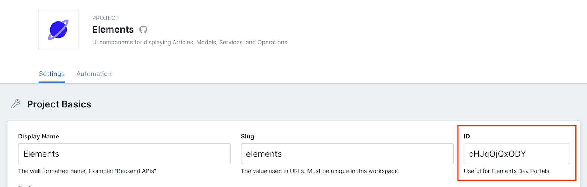

# Elements Dev Portal in React

Learn how to get started with Elements Dev Portal in a React project.

## Requirements

- React and React DOM **19.2.7 or later**.
- If your app has its own router, it has to be [React Router](https://reactrouter.com) 8. Elements uses the router of your app when it finds one. See [Migrating to Elements 10](../../guides/migrating-to-v10.md).

Coming from an earlier version of Elements? Read [Migrating to Elements 10](../../guides/migrating-to-v10.md).

## Quick Start with Vite

The quickest way to get an Elements Dev Portal website in a new React project is [Vite](https://vite.dev):

```bash
npm create vite@latest my-app -- --template react-ts
cd my-app
npm install @stoplight/elements-dev-portal vite-plugin-node-polyfills
```

Add the polyfills plugin to `vite.config.ts` as described in the [Vite](#vite) section below, then follow the [Manual Setup](#manual-setup) steps. Run `npm run dev` to start the development server.

> **Create React App** is no longer maintained and doesn't support React 19, so the Create React App templates for Elements (`cra-template-elements` and `cra-template-elements-dev-portal`) don't work with Elements 10.

## Manual Setup

To install Elements Dev Portal in an existing React app, follow these instructions.

1. Install the [`@stoplight/elements-dev-portal`](https://www.npmjs.com/package/@stoplight/elements-dev-portal) package with NPM/Yarn.

```bash
npm install @stoplight/elements-dev-portal
```

2. In `App.js` import the API component and CSS file from the Elements library.

```jsx
import { StoplightProject } from '@stoplight/elements-dev-portal';
import '@stoplight/elements-dev-portal/styles.min.css';
```

3. Find the **Project ID** from the **Project Settings** page in your Stoplight project. See [Project Settings](https://docs.stoplight.io/docs/platform/252039ebe8fb2-project-settings) for details.

> Project Settings can only be viewed by Project Editors or above. Read more about [project permissions](https://docs.stoplight.io/docs/platform/ZG9jOjg1NjcyNzE-manage-project-access#project-roles).



4. Now you can replace the existing App component's contents with the StoplightProject component.

```jsx
<StoplightProject projectId="INSERT_YOUR_PROJECT_ID_HERE" />
```

Now your `App.js` file should look something like this:

<!-- title: App.js -->
```jsx
import React from 'react';

import { StoplightProject } from '@stoplight/elements-dev-portal';
import '@stoplight/elements-dev-portal/styles.min.css';


function App() {
  return (
    <div className="App">
      <StoplightProject projectId="INSERT_YOUR_PROJECT_ID_HERE" />
    </div>
  );
}

export default App;
```

## Configuration

See [Dev Portal Configuration Options](dev-portal-options.md).

## Fire it up

Now start the development server.

```bash
npm run dev
```

(`npm start` in projects that were not created with Vite.)

And you should see the documentation of the project you configured, rendered by Elements Dev Portal.

## Vite

Elements dependencies expect some Node.js globals and built-ins (`global`, `process`, `url`, `buffer`), which Vite doesn't provide. Add [vite-plugin-node-polyfills](https://github.com/davidmyersdev/vite-plugin-node-polyfills) to your Vite config. See the [react-vite example](https://github.com/stoplightio/elements/tree/main/examples/react-vite) for a complete setup.

```js
// vite.config.ts
import react from '@vitejs/plugin-react';
import { defineConfig } from 'vite';
import { nodePolyfills } from 'vite-plugin-node-polyfills';

export default defineConfig({
  plugins: [react(), nodePolyfills()],
});
```

## Polyfills (webpack 5)

webpack 5 doesn't come with Node.js polyfills anymore. Since the dependencies of Elements use the `url` and `buffer` packages, they need to be added separately. The easiest way to do that is to add [node-polyfill-webpack-plugin](https://github.com/Richienb/node-polyfill-webpack-plugin) to your webpack configuration file:

```js
const NodePolyfillPlugin = require('node-polyfill-webpack-plugin');
...
plugins: [
  // Other plugins...
  new NodePolyfillPlugin(),
]
```

In case of Docusaurus it can be done by:
- installing `node-polyfill-webpack-plugin`
- creating a new file for the plugin such as `./plugins/webpackPolyfillPlugin.js`:
```js
// ./plugins/webpackPolyfillPlugin.js
const NodePolyfillPlugin = require('node-polyfill-webpack-plugin');

module.exports = function (context, options) {
  return {
    name: 'webpack-polyfill-plugin',
    configureWebpack(config, isServer, utils) {
      return {
        plugins: [new NodePolyfillPlugin()],
      };
    },
  };
};
```
- using the custom plugin in docusaurus configuration:
```js
// docusaurus.config.js
module.exports = {
  ...
  plugins: [
    ...
    require.resolve('./plugins/webpackPolyfillPlugin'),
  ],
};
```
Since Docusaurus makes use of SSR when running it with `StoplightProject`, default `history` (`BrowserRouter`) router should not be used.
